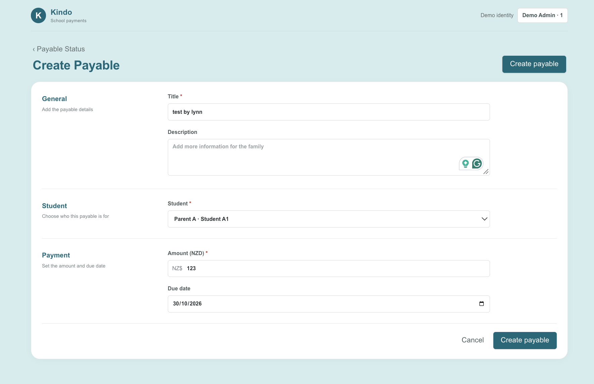
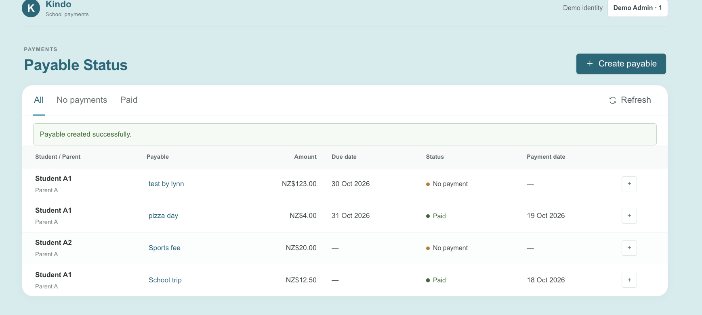
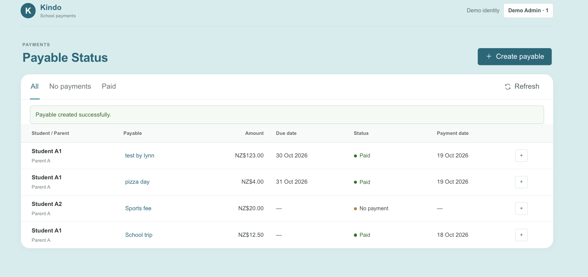
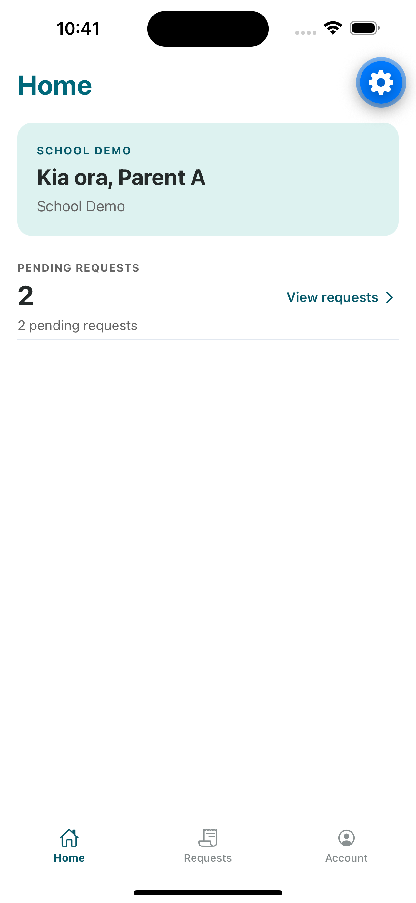
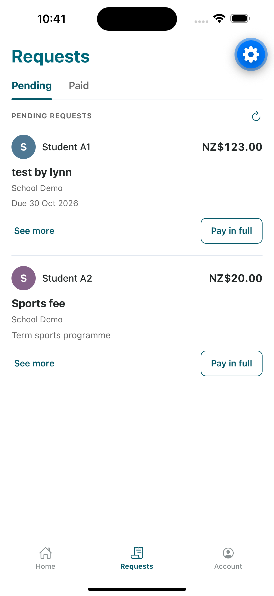
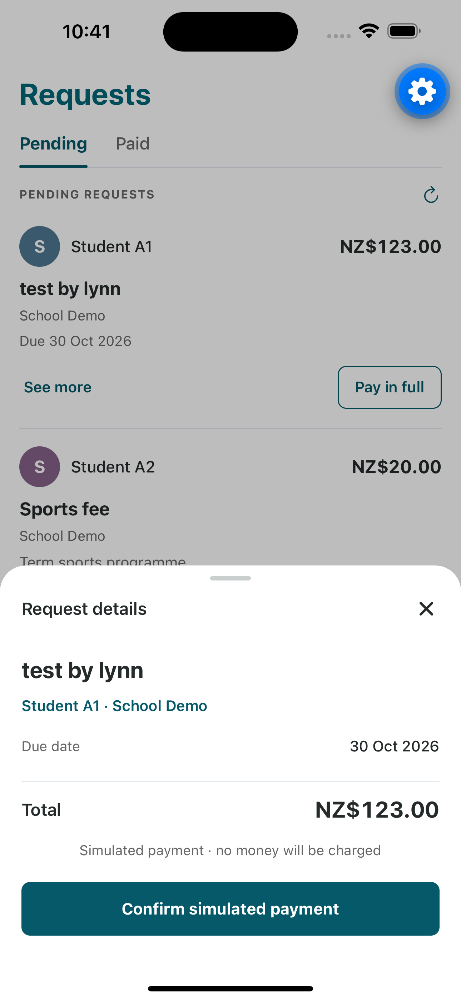
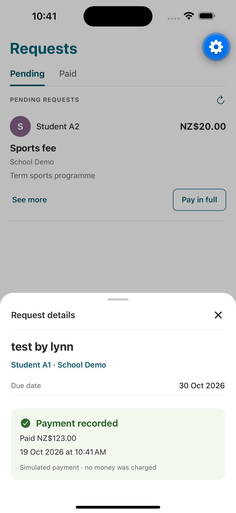

# Kindo School Payment Demo

A local full-stack demo for school administrators to create student-specific payables and for parents to review and simulate paying them.

## Architecture & Workflow

| Component | Technology | Responsibility |
| --- | --- | --- |
| Admin web | React, TypeScript, Vite, Tailwind CSS | Create payables and track payment status |
| Parent app | Expo, React Native, TypeScript | View requests by child and confirm simulated payment |
| API | FastAPI | Validate requests, enforce demo access rules, and coordinate payment transactions |
| Database | PostgreSQL | Store users, students, payables, and payment records |

**Workflow:** 
Admin creates a payable for one student → 
API validates it and stores it as open → 
the linked parent reviews it → 
the parent confirms a full simulated payment → 
the API records the payment and marks the payable paid → 
Admin sees the updated status.


## User Test Results

### Admin: create and track a payable



*Create Payable form: Student A1, “test by lynn”, NZ$123.00, due October 30, 2026.*



*The new payable is visible with “No payment” status before the parent pays.*



*After payment, the payable status is “Paid” with an October 19, 2026 payment date. Other students' requests remain independently tracked.*

### Parent: review and pay in the mobile app


<table>
  <tr>
    <td></td>
    <td></td>
    <td></td>
    <td></td>
  </tr>
</table>

Parent A sees two pending requests, each linked to the correct student, then reviews and confirms Student A1’s NZ$123.00 simulated payment. The app records the payment with its amount and timestamp, while Student A2’s NZ$20.00 request remains unpaid; no money is charged.

## Learning Reflection: Applying .NET Knowledge to Python and FastAPI

I used familiar .NET backend concepts as a map, then focused my learning on FastAPI conventions.

| Existing .NET concept | Python / FastAPI equivalent | How it helped | Related project files |
| --- | --- | --- | --- |
| ASP.NET Core controllers and routing | FastAPI routers and path operations | Mapped familiar routes, HTTP methods, and response codes | [api.py](backend/app/api.py) |
| C# DTOs and data annotations | Python type hints and Pydantic models | Applied request contracts and input validation | [schemas.py](backend/app/schemas.py) |
| Dependency injection and middleware | FastAPI `Depends` and middleware | Reused the idea of composing shared services and request rules | [auth.py](backend/app/auth.py), [api.py](backend/app/api.py), [main.py](backend/app/main.py) |
| EF Core entities and transactions | SQLAlchemy models, sessions, and transactions | Applied existing ORM and data consistency knowledge | [models.py](backend/app/models.py), [db.py](backend/app/db.py), [payments.py](backend/app/payments.py) |

**What I learned**

- I started with an end-to-end request flow and mapped known concepts before diving into new syntax.
- My .NET experience let me focus on Python/FastAPI specifics and mobile integration instead of learning backend fundamentals from scratch.
- Building this MVP over a weekend gave me practical experience with the new stack and showed how quickly I can ramp up.

## Requirements

- macOS or Linux; Docker Desktop / Docker Engine with Docker Compose
- Python 3.14.x
- Xcode and an iOS Simulator to run the parent app as demonstrated
- The project-pinned Node.js 24.22.0 (installed below); npm is bundled with Node

PostgreSQL runs in Docker and is published only on `127.0.0.1:55432`. The API, web dev server, and Expo dev server are local development services.

## First-time setup

Run these commands from the repository root. The local Node installer downloads the version pinned in `.nvmrc` and checks its SHA256 before extraction. It does not change your system Node installation.

```sh
python3 --version
python3 scripts/setup-node.py
scripts/with-node node --version
scripts/with-node npm --version

python3 -m venv backend/.venv
backend/.venv/bin/python -m pip install -r backend/requirements.lock

# Keep an existing .env; create it from the local-only example only when absent.
test -f .env || cp .env.example .env

(cd web && ../scripts/with-node npm ci)
(cd mobile && ../scripts/with-node npm ci)

docker compose up -d --wait
backend/.venv/bin/python -m alembic -c backend/alembic.ini upgrade head
PYTHONPATH=backend backend/.venv/bin/python -m app.seed
```

If this repository's existing PostgreSQL volume predates the test databases, create only the missing test databases with the idempotent initializer:

```sh
docker compose exec -T postgres psql -U kindo -d school_pay_demo < backend/docker/init-databases.sql
```

That command creates missing test databases; it does not drop or reset existing databases. Do not use `docker compose down -v` for normal shutdown: `-v` removes the persistent local data volume.

## Run the demo

Use three terminals from the repository root.

**1. API**

```sh
backend/.venv/bin/python -m uvicorn app.main:app --app-dir backend --host 127.0.0.1 --port 8000
```

The API docs are at <http://127.0.0.1:8000/docs>.

**2. Admin web app**

```sh
cd web
../scripts/with-node npm run dev -- --host 127.0.0.1
```

Open the URL Vite prints (normally <http://127.0.0.1:5173>). The admin app uses the API at `http://127.0.0.1:8000` by default; set `VITE_API_URL` before starting Vite only if you run the API elsewhere.

**3. Parent app in the iOS Simulator**

Make sure an iOS Simulator is available, then run:

```sh
cd mobile
EXPO_PUBLIC_API_URL=http://127.0.0.1:8000 ../scripts/with-node npm run ios
```

The app's Account tab lets you switch between the fictional parent identities. The iOS Simulator reaches the API on the Mac via `127.0.0.1`; the documented setup targets the simulator.

## Demo identities and walkthrough

The repeatable `seed` command inserts missing fictional users and students without changing payment requests or payments already in the demo database.

The current local demo database already contains the acceptance example below: A1's `School trip` for NZ$12.50 is paid, while A2's `Sports fee` for NZ$20.00 remains open. On a fresh demo database, create those two requests in the admin app before following the payment steps.

| Demo identity | ID | Students |
| --- | ---: | --- |
| Demo Admin | 1 | — |
| Parent A | 2 | Student A1 (101), Student A2 (102) |
| Parent B | 3 | Student B1 (103) |

1. If the two sample requests do not exist yet, create `School trip` for Student A1 at NZ$12.50 and `Sports fee` for Student A2 at NZ$20.00 in the admin web app.
2. In the simulator, open Requests as Parent A. Confirm both items are associated with the correct student.
3. For a fresh scenario where both are open, confirm the simulated full payment for A1. Check that A1 is paid and A2 remains open.
4. Refresh the admin list and confirm it shows A1 as paid and A2 as open. Switch the parent app to Parent B and confirm it cannot see Parent A's requests.

The clients send `X-Demo-User-Id` (`1` for the administrator, `2` or `3` for a parent). This is an easily switchable demo identity, not authentication or authorization suitable for deployment. The payment endpoint records a local simulated payment for the request's full amount; it never charges money.

## Tests and checks

For a read-only prerequisite check before a demo, run:

```sh
scripts/demo-preflight.sh
```

It checks Docker/PostgreSQL health, local Python and Node dependencies, installed client packages, and iOS Simulator availability. It does not start services or alter databases.

To run the complete automated quality suite in sequence, run:

```sh
scripts/check-all.sh
```

The backend tests use only the guarded test databases described below; the web and mobile suites do not write demo records.

**Backend** — Docker/PostgreSQL must be running. The backend suite uses the dedicated test databases, not the demo database:

```sh
APP_ENV=test backend/.venv/bin/python -m pytest backend/tests -q
backend/.venv/bin/python -m pip check
```

Set `APP_ENV=test` explicitly. Ordinary database tests clear rows only in `school_pay_demo_test`; the migration test runs migrations on `school_pay_demo_migration_test`. Database guards reject missing or mismatched test configuration and reject the demo database. Tests use real PostgreSQL commits and are serial; do not run them with `pytest-xdist`.

**Web**

```sh
cd web
../scripts/with-node npm test
../scripts/with-node npm run lint
../scripts/with-node npm run build
```

**Parent app**

```sh
cd mobile
../scripts/with-node npm run test:ci
../scripts/with-node npm run typecheck
../scripts/with-node npm run lint
```

The Expo project also supports `../scripts/with-node npx expo-doctor` for an environment/configuration check.

## Data and shutdown

The demo database is `school_pay_demo`; the two test databases are `school_pay_demo_test` and `school_pay_demo_migration_test`. Local connection settings live in `.env` and are intentionally excluded from version control. The example values are fictional local credentials, not production secrets. The Postgres data is kept in the Compose volume across restarts.

Stop the API, Vite, and Expo processes with Ctrl+C in their terminals. Stop PostgreSQL while keeping its data with:

```sh
docker compose stop
```

Restart it later with `docker compose up -d --wait`. Rerun the Alembic upgrade and seed commands if needed; both are safe to repeat and do not reset existing requests or payments.
